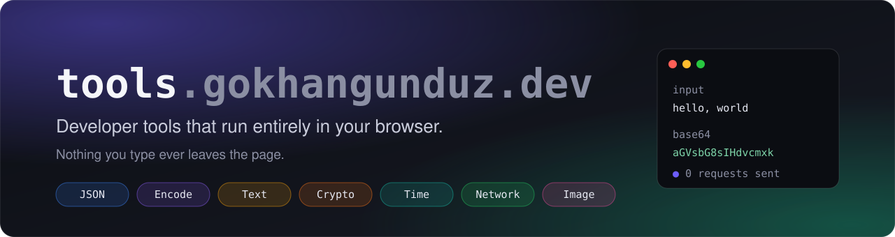
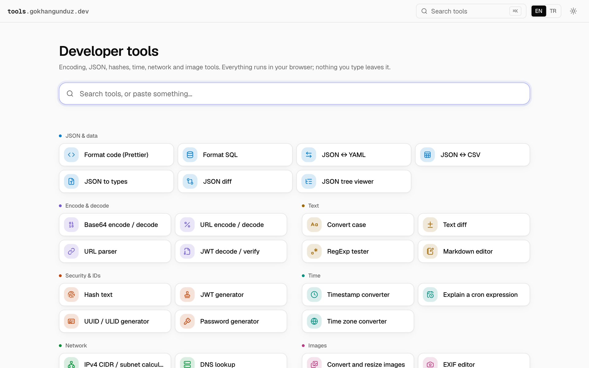
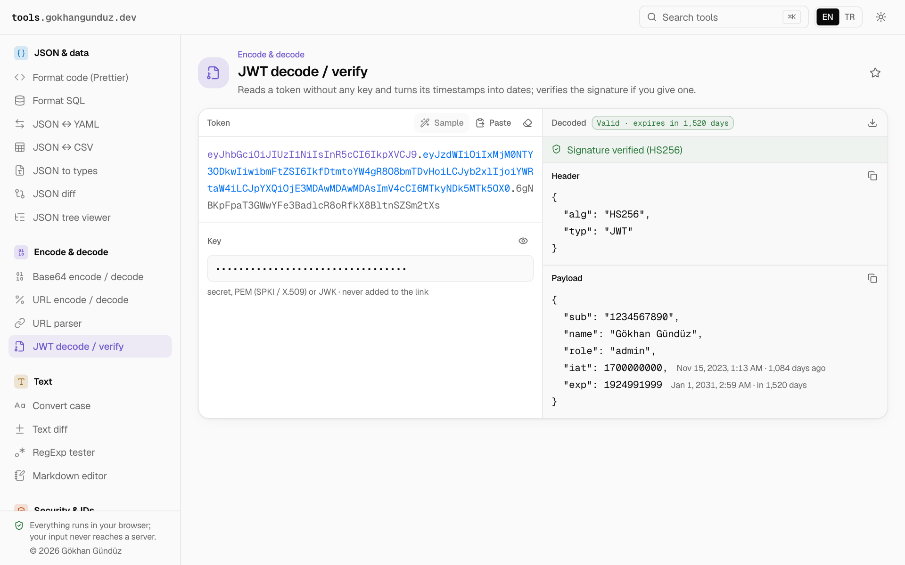
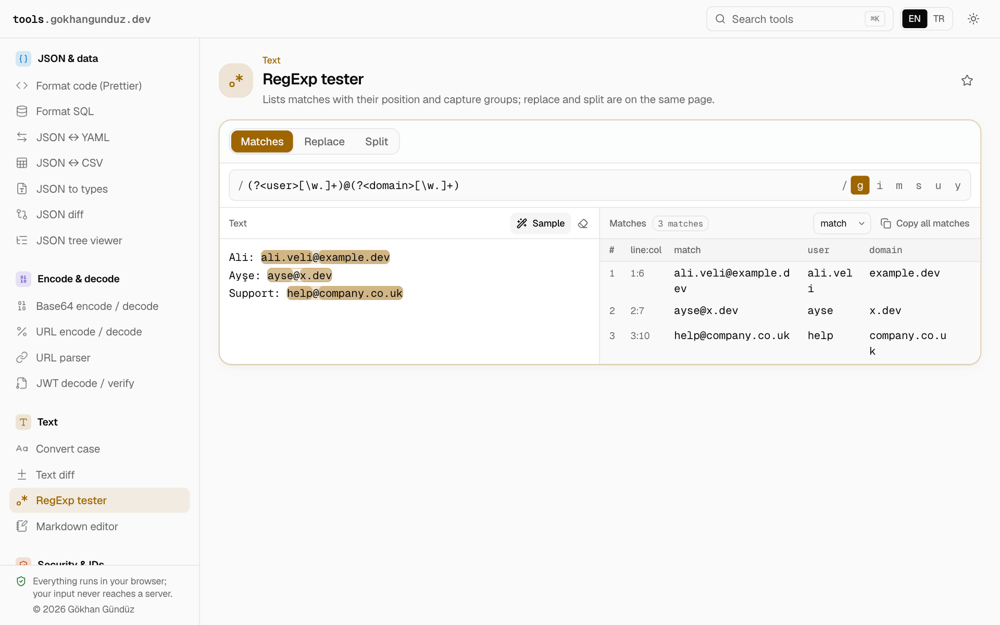
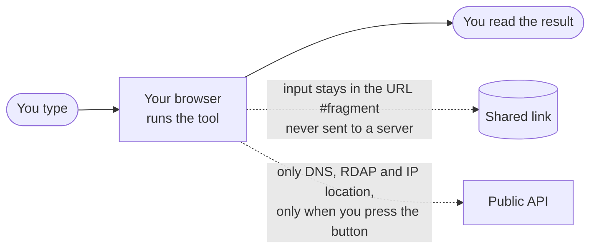

<div align="center">

<a href="https://tools.gokhangunduz.dev">
  
</a>

<br>

[](https://github.com/gokhangunduz/tools.gokhangunduz.dev/actions/workflows/ci.yml)
[](https://github.com/gokhangunduz/tools.gokhangunduz.dev/releases)
[](LICENSE)


**[Open the site →](https://tools.gokhangunduz.dev)** &nbsp;·&nbsp; [Tools](#-tools) &nbsp;·&nbsp; [Privacy](#-privacy-model) &nbsp;·&nbsp; [Run locally](#-run-it-locally) &nbsp;·&nbsp; [Contribute](#-contributing)

</div>

<br>

<p align="center">
  <picture>
    <source media="(prefers-color-scheme: dark)" srcset="docs/screenshots/home-dark.png">
    
  </picture>
</p>

## ✨ Why this exists

Most online "paste your token here" tools send what you paste to a server you know nothing about. These don't. Every conversion is plain client-side code, so you can decode a production JWT or hash a secret without wondering where it went.

|  |  |  |
|---|---|---|
| 🔒 **Private by construction**<br>No backend, no analytics, no third-party script or font. Nothing you type leaves the page. | ⚡ **Fast to reach**<br>Press <kbd>⌘</kbd> <kbd>K</kbd> or <kbd>Ctrl</kbd> <kbd>K</kbd> and find any tool by name or keyword. | 🔗 **Shareable**<br>Your input lives in the URL fragment, so a link reproduces what you see and still never reaches a server. |
| ✈️ **Works offline**<br>A service worker keeps the site available after the first visit, so the tools open on a plane. | 🌍 **Bilingual**<br>Every string exists in English and Turkish, one click apart in the header. | 🌗 **Light and dark**<br>Both themes are first-class and follow your system by default. |

## 🖼️ A look inside

Every tool shares one layout: input on the left, result on the right, a sample button, and copy and download where they make sense.

<table>
  <tr>
    <td width="50%" align="center">
      <picture>
        <source media="(prefers-color-scheme: dark)" srcset="docs/screenshots/jwt-decode-dark.png">
        
      </picture>
      <br><sub><b>JWT decode / verify</b>: timestamps become dates, and the key never goes into the link</sub>
    </td>
    <td width="50%" align="center">
      <picture>
        <source media="(prefers-color-scheme: dark)" srcset="docs/screenshots/regex-test-dark.png">
        
      </picture>
      <br><sub><b>RegExp tester</b>: highlighted matches, capture groups, replace and split</sub>
    </td>
  </tr>
</table>

## 🧰 Tools

Thirty tools in seven categories. Every name links to the live page.

<table>
<tr>
<td valign="top" width="50%">

**🟦 JSON & data**
- [Format code](https://tools.gokhangunduz.dev/en/format-code): Prettier itself, in the browser
- [Format SQL](https://tools.gokhangunduz.dev/en/sql-format): dialect-aware keywords
- [JSON ↔ YAML](https://tools.gokhangunduz.dev/en/json-yaml)
- [JSON ↔ CSV](https://tools.gokhangunduz.dev/en/json-csv)
- [JSON to types](https://tools.gokhangunduz.dev/en/json-to-types): TypeScript, Zod, Go, JSON Schema
- [JSON diff](https://tools.gokhangunduz.dev/en/json-diff): by path, not by line
- [JSON tree viewer](https://tools.gokhangunduz.dev/en/json-viewer): with JSONPath per row

**🟪 Encode & decode**
- [Base64](https://tools.gokhangunduz.dev/en/base64-text): UTF-8, URL-safe alphabet
- [URL encode / decode](https://tools.gokhangunduz.dev/en/url-encode)
- [URL parser](https://tools.gokhangunduz.dev/en/url-parse)
- [JWT decode / verify](https://tools.gokhangunduz.dev/en/jwt-decode)

**🟨 Text**
- [Convert case](https://tools.gokhangunduz.dev/en/case-convert): Turkish İ/ı handled correctly
- [Markdown editor](https://tools.gokhangunduz.dev/en/markdown-editor)
- [RegExp tester](https://tools.gokhangunduz.dev/en/regex-test)
- [Text diff](https://tools.gokhangunduz.dev/en/text-diff): by line, word or character

</td>
<td valign="top" width="50%">

**🟧 Security & IDs**
- [Hash text](https://tools.gokhangunduz.dev/en/hash-text): MD5, SHA-1/2/3, CRC32
- [JWT generator](https://tools.gokhangunduz.dev/en/jwt-generate): HS256/384/512
- [Password generator](https://tools.gokhangunduz.dev/en/password): shows entropy and crack time
- [UUID / ULID generator](https://tools.gokhangunduz.dev/en/uuid): v4, v7, ULID, Nano ID

**🟩 Time**
- [Cron explainer](https://tools.gokhangunduz.dev/en/cron): next runs in your time zone
- [Timestamp converter](https://tools.gokhangunduz.dev/en/timestamp)
- [Time zone converter](https://tools.gokhangunduz.dev/en/timezone): DST included

**🟢 Network**
- [IPv4 CIDR calculator](https://tools.gokhangunduz.dev/en/cidr)
- [DNS lookup](https://tools.gokhangunduz.dev/en/dns-lookup) ¹
- [IP location and ASN](https://tools.gokhangunduz.dev/en/ip-geo) ¹
- [WHOIS / RDAP lookup](https://tools.gokhangunduz.dev/en/rdap) ¹

**🩷 Image**
- [EXIF editor](https://tools.gokhangunduz.dev/en/exif): finds and strips location data
- [Image to Base64](https://tools.gokhangunduz.dev/en/image-base64)
- [Convert and resize images](https://tools.gokhangunduz.dev/en/image-convert): WebP, JPEG, PNG
- [QR code generator](https://tools.gokhangunduz.dev/en/qr-generate): SVG output

</td>
</tr>
</table>

¹ **Needs the network.** These three can't be done in the browser alone, so they query a public API. The page names the service and says so before anything is sent. Every other tool makes no requests.

## 🔒 Privacy model



| | |
|---|---|
| **Where the work happens** | In your browser, in plain JavaScript. There is no server to receive it. |
| **Shared links** | Input is stored after the `#` in the URL. Browsers never send the fragment to a server. |
| **Secrets** | Tools that handle keys or passwords keep them out of the shared link. |
| **Third-party requests** | Only the three tools marked above, and only when you press the button. |
| **Third-party code** | None. No analytics, no tag manager, no hosted fonts. |

Found a way for input to leave the page? That is the most serious kind of bug here. Please [open an issue](https://github.com/gokhangunduz/tools.gokhangunduz.dev/issues/new/choose).

## 🚀 Run it locally

Requires Node.js 24.

```bash
git clone https://github.com/gokhangunduz/tools.gokhangunduz.dev.git
cd tools.gokhangunduz.dev
npm install
npm run dev        # http://localhost:3000
```

| Command | What it does |
|---|---|
| `npm run dev` | Development server |
| `npm test` | Unit tests for every tool's logic (Vitest) |
| `npm run lint` | ESLint |
| `npm run format:check` | Prettier |
| `npm run build` | Static export into `out/` |
| `npm run verify` | Everything: invariants, types, tests, lint, build, and a browser smoke run over every tool in both languages |

## 🏗️ How it's built

<p>
  
  
  
  
  
  
  
  
</p>

The site is exported to plain HTML and deployed on Cloudflare Pages straight from this repository. There is no server, so a feature that needs one doesn't exist.

```
src/
├── app/          routes, layout and global styles
├── components/   shared editor chrome and the runners every tool is built from
├── i18n/         interface strings (en.json, tr.json)
└── tools/        one folder per tool, plus the registry
verify/           the checks behind `npm run verify`
scripts/          the browser smoke test
docs/             the banner and screenshots used in this README
```

Each tool is a folder under `src/tools/<id>/`:

| File | Role |
|---|---|
| `logic.ts` | The conversion, as a pure function. No React, no DOM. |
| `logic.test.ts` | Tests: non-ASCII input, empty input, rejected input, round trips. |
| `spec.ts` / `Tool.tsx` | The interface, built from the shared panels. |
| `meta.ts` | Name, description, keywords and category, in both languages. |

The home page, search, command palette, sidebar and sitemap are all generated from one registry, `src/tools/registry.ts`, so adding a tool is one folder and one line.

## 🤝 Contributing

Bug reports, tool ideas and pull requests are welcome. Start with [CONTRIBUTING.md](CONTRIBUTING.md), which covers the ground rules and how to add a tool. Questions and ideas are welcome in [Discussions](https://github.com/gokhangunduz/tools.gokhangunduz.dev/discussions).

## 📄 License

[MIT](LICENSE) © 2025 Gökhan Gündüz
